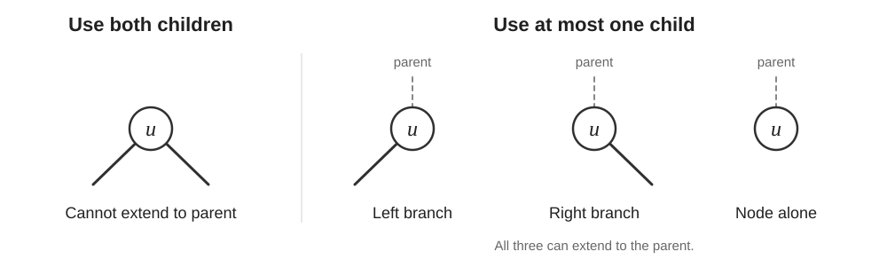

## Tree path DP

Return the best path using at most one child branch. Consider joining both child branches through the current node when updating the global best.

* [LeetCode #543: Diameter of Binary Tree](https://leetcode.com/problems/diameter-of-binary-tree/):
  child contributions are nonnegative path lengths.
* [LeetCode #124: Binary Tree Maximum Path Sum](https://leetcode.com/problems/binary-tree-maximum-path-sum/):
  discard negative child contributions; the node alone remains
  a valid candidate.

## Binary search

* **Search within the data:** Use the input’s ordering to determine which half could contain the target. Example: [LeetCode #33: Search in Rotated Sorted Array](https://leetcode.com/problems/search-in-rotated-sorted-array/).

* **Search the answer space:** Find the smallest or largest answer satisfying a monotonic condition—one whose truth value changes at most once as candidate answers increase. The input itself need not be sorted. Example: [LeetCode #875: Koko Eating Bananas](https://leetcode.com/problems/koko-eating-bananas/).