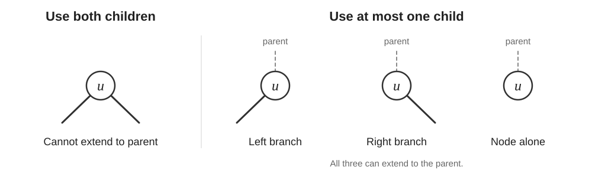

## Multi-source BFS

Start BFS from all sources at once, letting the search expand outward from them together.

* [LeetCode #994: Rotting Oranges](https://leetcode.com/problems/rotting-oranges/):
  start from all rotten oranges; each BFS layer represents one minute of spread.
* [LeetCode #542: 01 Matrix](https://leetcode.com/problems/01-matrix/):
  start from all zeros to find each cell’s distance to its nearest zero.
* [LeetCode #417: Pacific Atlantic Water Flow](https://leetcode.com/problems/pacific-atlantic-water-flow/):
  search backward from each ocean’s boundaries, moving to equal-or-higher cells; intersect the two reachable sets.

## Tree path DP

* [LeetCode #543: Diameter of Binary Tree](https://leetcode.com/problems/diameter-of-binary-tree/):
  child contributions are nonnegative path lengths.
* [LeetCode #124: Binary Tree Maximum Path Sum](https://leetcode.com/problems/binary-tree-maximum-path-sum/):
  discard negative child contributions; the node alone remains
  a valid candidate.

## Binary search

* **Search within the data:** Use the input’s ordering to determine which half could contain the target. Example: [LeetCode #33: Search in Rotated Sorted Array](https://leetcode.com/problems/search-in-rotated-sorted-array/).

* **Search the answer space:** Find the smallest or largest answer satisfying a monotonic condition—one whose truth value changes at most once as candidate answers increase. The input itself need not be sorted. Example: [LeetCode #875: Koko Eating Bananas](https://leetcode.com/problems/koko-eating-bananas/).