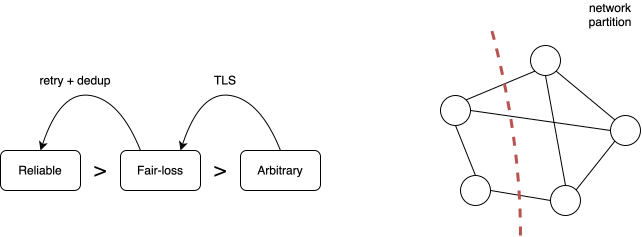

## Assumptions
* Network behavior

* Node behavior

* Timing behavior

## Failure models
* Two generals problem
* Byzantine generals problem

## Messaging layer
* RPC: REST
* IDL: Protocol buffer or Thrift

## Sources
* Kleppmann's 2021 lectures:
    - [videos](https://www.youtube.com/playlist?list=PLeKd45zvjcDFUEv_ohr_HdUFe97RItdiB)
    - [notes](https://www.cl.cam.ac.uk/teaching/2021/ConcDisSys/dist-sys-notes.pdf)