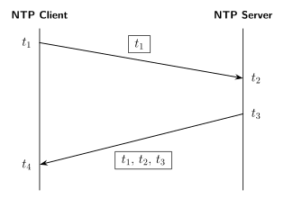
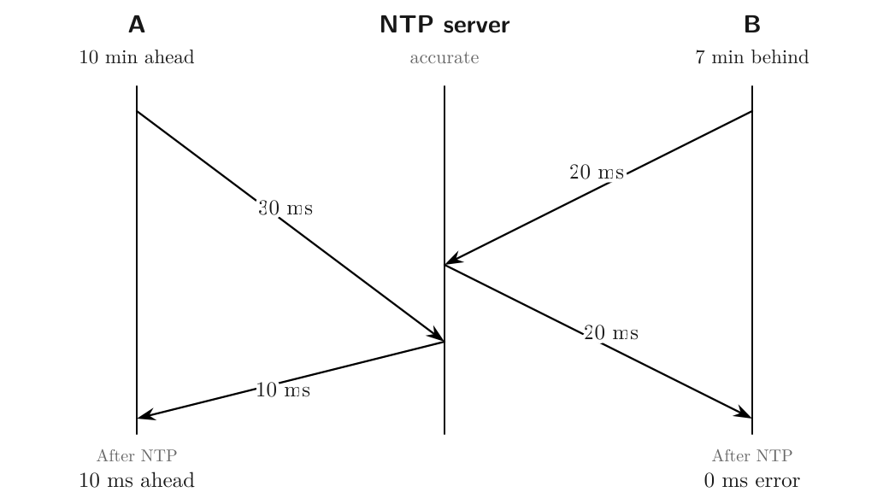
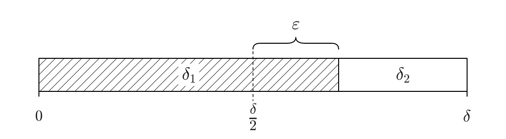
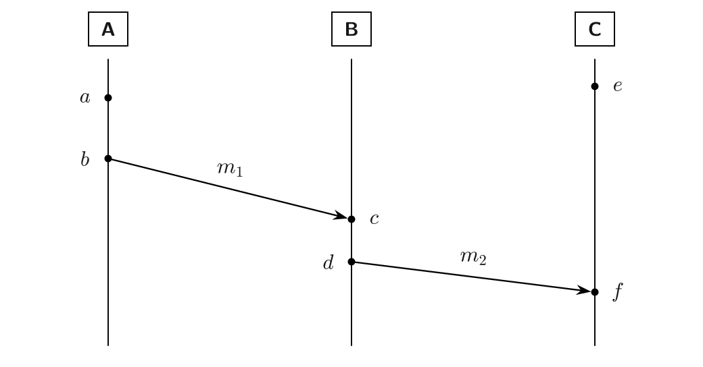
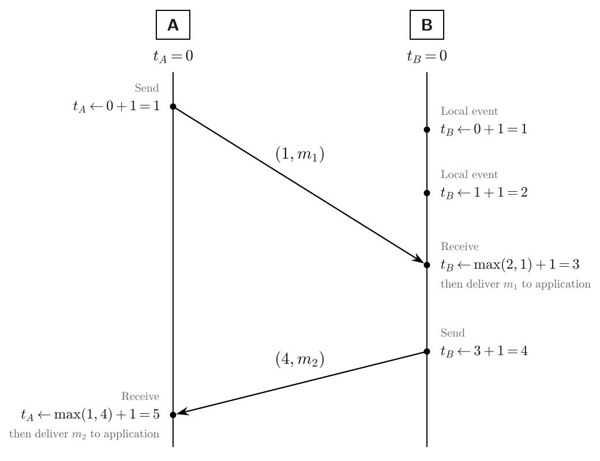
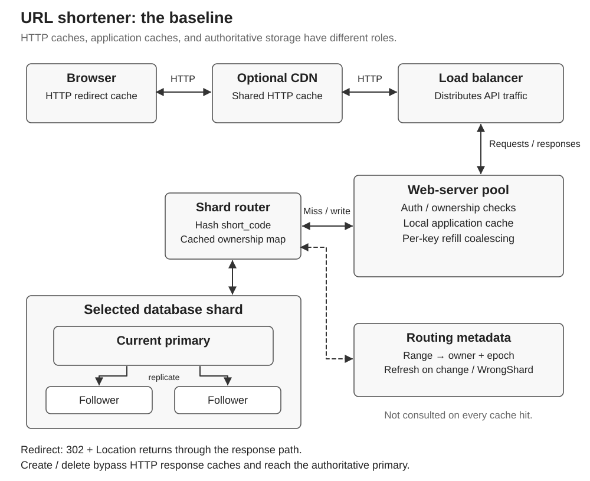
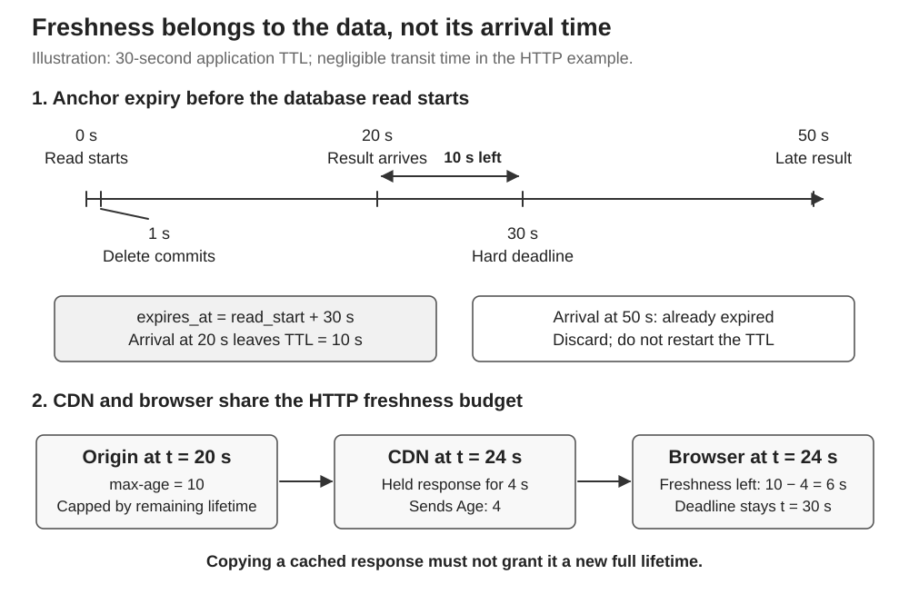
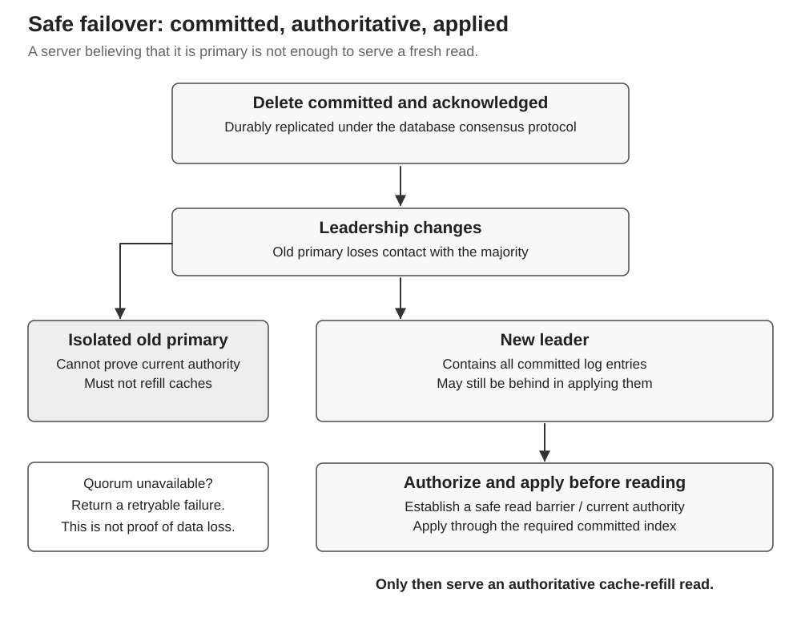
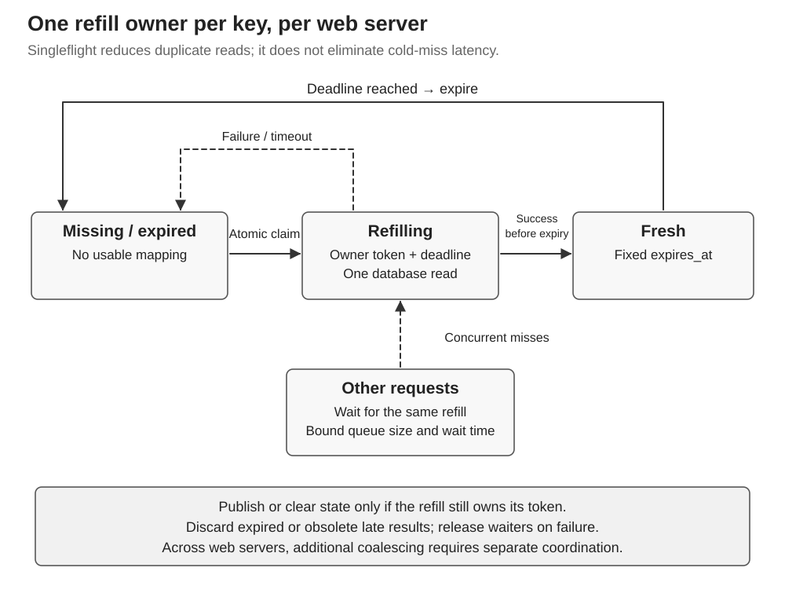
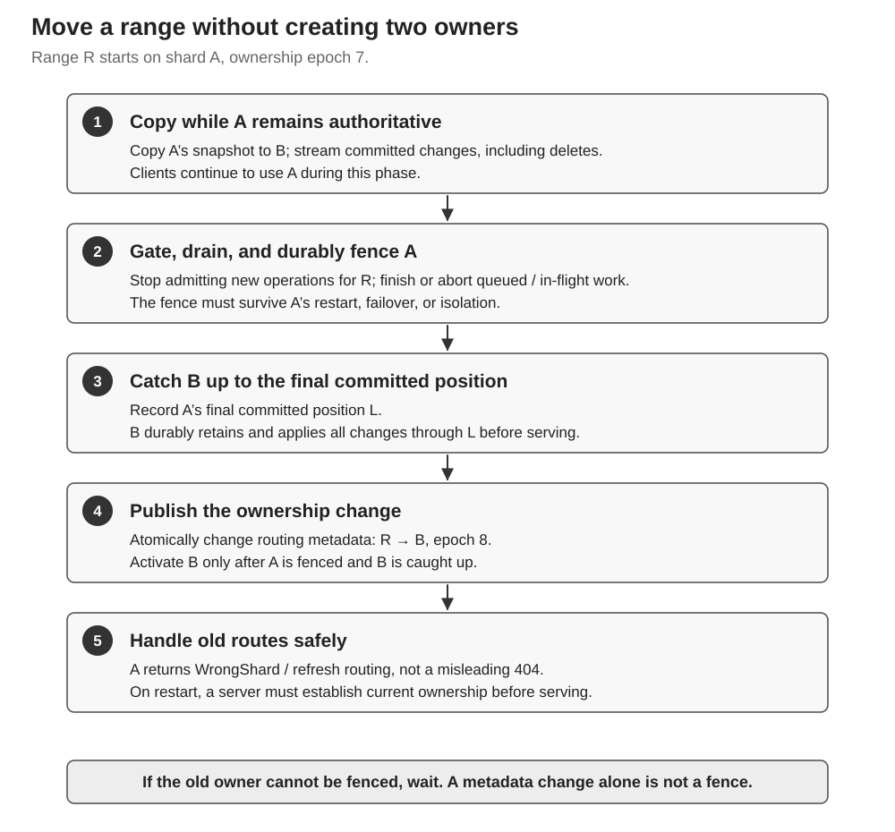

```{=html}
<style>
.quarto-figure figcaption {
  text-align: center !important;
}
</style>
```

# Clocks
Being able to timestamp (a strictly monotonically increasing sequence) events is useful because:

* Elapsed time (using [monotonic clock](https://docs.python.org/3/library/time.html#time.monotonic)) is a proxy for performance.
* A timestamp bigger than the current timestamp can serve as deadline.
* Cause has a lower timestamp than its effect.

## Clock synchronization

{width=75%}

Roundtrip network delay: $\delta = (t_4 - t_1) - (t_3 - t_2)$. Assuming the network delay is the same in both directions, when client is at $t_4$ the server is at $t_3+\frac{\delta}{2}$. Consequently, client's clock skew: $\theta = \left(t_3+\frac{\delta}{2}\right)-t_4 = \frac{(t_2-t_1)+(t_3-t_4)}{2}$.

If the network delay is not the same in both directions, even with NTP synchronization, there could be residual errors.



Say between client and an NTP server, the total, forward and return network delays are $\delta$, $\delta_1$ and $\delta_2$. And say $\epsilon$ is the error that remains after NTP synchronization.



$$
\begin{align}
\epsilon &= \delta_1 - \frac{\delta}{2}\\
         &= \delta_1 - \frac{\delta_1 + \delta_2}{2} \\
         &= \frac{\delta_1 - \delta_2}{2} \\
         &= \frac{ \text{forward-delay} - \text{return-delay} }{2}
\end{align}
$$

## Message ordering using logical clocks



* Events local to one node: $a \rightarrow b$, $c \rightarrow d$, $e \rightarrow f$
* Send, receive events: $b \rightarrow c$, $d \rightarrow f$
* Transitivity: $a \rightarrow c$, $a \rightarrow d$, $a \rightarrow f$, $b \rightarrow d$, $b \rightarrow f$, $c \rightarrow f$
* Concurrent (or causally unrelated): $a \parallel e$, $b \parallel e$, $c \parallel e$, $d \parallel e$

For a logical clock, minimum requirement is: $(a \rightarrow b) \implies (T(a) < T(b))$

### Lamport clock


- $(a \rightarrow b) \implies (L(a) < L(b))$. Contrapositively, $(L(a) \ge L(b)) \implies (a \nrightarrow b)$. For example, if $L(a) = 10$ and $L(b) = 5$, we know $a \nrightarrow b$, but cannot distinguish between $b \rightarrow a$ and $a \parallel b$.
- $(L(a) < L(b)) \nRightarrow (a \rightarrow b)$. Comparing Lamport timestamps cannot establish whether one event causally preceded another. Vector clocks address this limitation by allowing us to distinguish causally ordered events from concurrent events.

### Vector clock

# Fault tolerance
* (Eventually Perfect) Failure detector
    - Timeout


# Availability

| Nines | Availability | Equivalent downtime/year | Service example | Use case and cost of an outage |
|---|---:|---:|---|---|
| **2** | 99% | **3.65 days** | Personal blog | Readers can return later; interruptions usually cause limited harm. |
| **3** | 99.9% | **8.76 hours** | Gmail in Google Workspace—[SLA](https://workspace.google.com/terms/sla/) | Business email: outages delay communication and everyday work. |
| **4** | 99.99% | **52.6 minutes** | Amazon EC2 across multiple availability zones—[SLA](https://aws.amazon.com/compute/sla/) | Servers running a large online store’s checkout: outages block orders and lose sales. |
| **5** | 99.999% | **5.26 minutes** | Google Spanner across multiple regions—[SLA](https://cloud.google.com/spanner/sla) | Database supporting payment processing: outages prevent customers from paying and merchants from completing transactions. |

Each additional nine reduces the downtime budget by **10×**.

## SLO, SLA

# Assumptions
* Network behavior


* Node behavior


* Timing behavior


# Failure models
* Two generals problem
* Byzantine generals problem

# Messaging layer
* RPC, REST
* Language-agnostic IDL: Protocol buffer or Thrift

# Sources
* Kleppmann's 2021 lectures:
    - [videos](https://www.youtube.com/playlist?list=PLeKd45zvjcDFUEv_ohr_HdUFe97RItdiB)
    - [notes](https://www.cl.cam.ac.uk/teaching/2021/ConcDisSys/dist-sys-notes.pdf)
* [Caching challenges and strategies from AWS](https://builder.aws.com/content/3K9TeXp6strMiJ4vhakpRD7BQWO/caching-challenges-and-strategies)

# URL shortener {#url-shortener}

<details id="url-shortener-design">
<summary></summary>

A URL shortener has a small interface: create a link, redirect a visitor, and delete a link. The interesting design work begins when those operations have to keep their promises during delays and failures.

Here, the most consequential promise is that a deletion takes effect within **60 seconds**. That requirement connects almost everything: cache expiration, delayed database responses, replica lag, leader failover, browser caching, and moving data between shards.

### 1. Clarify the problem before drawing boxes {#url-shortener-1-clarify-the-problem-before-drawing-boxes}

These questions determine which system we are actually building.

| Clarifying question | Working answer or unresolved choice |
|---|---|
| What operations are required? | Create, redirect, and delete. Editing destinations, custom aliases, analytics, and listing a user's links are optional follow-ups. |
| Does “one billion requests” mean creations or redirects? | **One billion redirects/day**, separate from **10 million new links/day**. |
| Are redirects public or permission checked? | Assume public bearer links for this baseline. Creation and deletion use authenticated identities. Private redirects need different authorization and cache rules. |
| Who may delete a link? | Its authenticated owner. Knowing a short code is not authorization to delete it. |
| What does “below 100 ms at p95” measure? | Working interpretation: the shortener's redirect response, including its internal waiting and database work. It excludes loading the destination page. Client geography and network time must be clarified before promising a global client-observed target. |
| What is peak traffic, rather than the daily average? | Not specified. Keep peak and burst factors as explicit sizing inputs. |
| How long are links retained? | Five years is the sizing horizon. Actual expiry and retention rules remain a product decision. |
| How large can an original URL be? | Not specified. Measure the distribution and enforce a chosen maximum; a small average is not an upper bound. |
| What does “deleted within 60 seconds” mean? | Use the precise contract below. It is a bound on serving a deleted redirect, not a promise to erase knowledge from clients. |
| Does the deletion clock start at receipt, database commit, or acknowledgment? | This post uses **successful acknowledgment** as the external reference point. Commit happens before acknowledgment. |
| Must deletion remain visible after an immediate primary crash? | Yes. Acknowledgment must imply the delete survives the supported failover model. |
| May the service fail a request when it cannot establish freshness? | Yes in this baseline. A retryable failure is preferable to serving a mapping that may violate deletion. The availability target is still unspecified. |
| Are codes ever reused or destinations edited? | Assume immutable destinations and no code reuse within the supported lifetime. Reuse requires additional rules for old bookmarks, negative caches, and deletion records. |
| Which regions must be supported? | Deployment requirements remain unresolved; the worked baseline below chooses one home write region. Cross-region latency and disaster recovery need additional guarantees. |

#### A deletion contract that can be tested {#url-shortener-a-deletion-contract-that-can-be-tested}

After a successful deletion acknowledgment at time $a$, **new redirect requests initiated after $a+60$ seconds must not receive the deleted mapping from service-controlled components and compliant HTTP caches**.

When an authoritative lookup confirms absence, return `404 Not Found` (or a deliberately chosen `410 Gone` policy). When freshness cannot be established, return an appropriate retryable error. A `503` does **not** assert that the link is absent.

This contract does not retract a redirect already delivered, close an already opened destination, stop someone visiting the original URL directly, or control a client that ignores cache rules. Arbitrarily delayed responses to older requests also require separate treatment; a TTL cannot recall a response already in transit. Clock behavior and HTTP cache compliance are assumptions in the timing argument, not invisible guarantees.

### 2. Estimate scale, then identify what the estimates omit {#url-shortener-2-estimate-scale-then-identify-what-the-estimates-omit}

There are 86,400 seconds in a day:

$$
\lambda_{\text{create}}=\frac{10^7}{86{,}400}\approx116/\text{s},
\qquad
\lambda_{\text{redirect}}=\frac{10^9}{86{,}400}\approx11{,}574/\text{s}.
$$

Using roughly 80,000 seconds/day gives 125 creations/s and 12,500 redirects/s. That is reasonable interview rounding, provided it is identified as such. The read-to-create ratio is about **100:1**.

#### How much data is five years of links? {#url-shortener-how-much-data-is-five-years-of-links}

Assuming 365 days/year and retaining all created codes:

$$
N=10^7\times365\times5=18.25\text{ billion}.
$$

The initial record sketch was `short_code`, `original_url`, and `user_id`. A rough estimate of 20 + 100 + 20 bytes adds to **140 bytes**, not 256. We can nevertheless choose **256 bytes/record as an explicit planning allowance** for representation and some metadata; it is not a measured row size.

| Quantity | Estimate |
|---|---:|
| Five-year population | 18.25 billion codes |
| Logical data at 256 bytes/record | 4.672 TB |
| Three full copies of that logical data | 14.016 TB |

These are decimal TB. Indexes, row and storage-engine overhead, logs, backups, compaction space, migration copies, and operational headroom can increase the physical footprint. Long original URLs can change the estimate substantially. User-profile data belongs in a separate identity/user store rather than being copied into every link row.

#### How much does caching reduce database traffic? {#url-shortener-how-much-does-caching-reduce-database-traffic}

If the **application cache** hit rate is 95% and all redirect traffic reaches the web-server tier, the average database read rate is approximately:

$$
(1-0.95)\times11{,}574\approx579\text{ reads/s}.
$$

Add roughly 116 creations/s, plus deletes and other operations. The rounded discussion estimate was 580 reads/s and 116 creates/s. If a CDN absorbs some requests first, apply the application-cache hit ratio to the traffic that actually reaches the application; do not mix hit ratios measured at different layers.

With an empty application cache, reads can approach **11,574/s before peak factors**: about 20 times the warm-cache read estimate. A warm-cache average alone is therefore insufficient to size the database.

#### Can one primary handle the workload? {#url-shortener-can-one-primary-handle-the-workload}

The answer requires measurements. Check usable storage, working-set memory, index behavior, CPU, I/O, mixed read/write throughput, connection pools, replica overhead, and recovery time. A large number of browser connections does not imply one database connection per browser; the web tier should pool database connections.

Shard count must satisfy both storage and load constraints with headroom. Hash balance also does not imply request balance: one viral link can dominate a shard. The exact database product, hardware, shard count, peak factor, and availability SLO remain open choices.

For an initial lower bound, let $B$ be logical bytes, $C_B$ the usable logical bytes per primary with headroom, $R_{\mathrm{peak}}$ the cold-read peak, and $C_R$ the measured read capacity per primary under the intended mixed workload:

$$
S\ge\left\lceil\max\left(\frac{B}{C_B},\frac{R_{\mathrm{peak}}}{C_R}\right)\right\rceil.
$$

Also check write load and hot keys. This is a sizing bound, not a substitute for load testing. For example, a **hypothetical** 10× daily-average burst gives about 115,740 redirects/s; use the interviewer's actual peak assumption when one is available. Replica copies multiply the machine/storage budget, not the number of independent writable partitions.

### 3. Define the API and its semantics {#url-shortener-3-define-the-api-and-its-semantics}

| Operation | Request | Success |
|---|---|---|
| Create | `POST /urls` with the destination in JSON | `201 Created`, returning the short URL |
| Redirect | `GET /Ab3x9Qp2` | `302 Found` with `Location` pointing to the destination |
| Delete | `DELETE /Ab3x9Qp2` | `204 No Content` after the durable deletion condition is met |

The code and domains below are illustrative. Framing and authentication details not relevant to an example are omitted.

```http
POST /urls HTTP/1.1
Host: s.example
Authorization: Bearer <token>
Content-Type: application/json

{"url":"https://example.com/articles/a-long-title"}
```

```http
HTTP/1.1 201 Created
Location: https://s.example/Ab3x9Qp2
Content-Type: application/json
Cache-Control: no-store

{"shortened_url":"https://s.example/Ab3x9Qp2"}
```

```http
GET /Ab3x9Qp2 HTTP/1.1
Host: s.example
```

```http
HTTP/1.1 302 Found
Location: https://example.com/articles/a-long-title
Cache-Control: public, max-age=15, must-revalidate
Content-Length: 0
```

The redirect's `max-age` is an example upper bound. Later we will make it depend on the remaining freshness of the application-cache entry.

```http
DELETE /Ab3x9Qp2 HTTP/1.1
Host: s.example
Authorization: Bearer <token>
```

```http
HTTP/1.1 204 No Content
Cache-Control: no-store
```

#### Why does the endpoint still matter when the request has JSON? {#url-shortener-why-does-the-endpoint-still-matter-when-the-request-has-json}

The method and request target identify the operation and resource. The body supplies data for that operation. `{"url": ...}` does not replace `POST /urls`.

#### Why POST if PUT can also create? {#url-shortener-why-post-if-put-can-also-create}

POST fits a service that assigns the code. PUT is appropriate when the client selects the target resource URI and requests its creation or replacement. Neither is universally more beneficial; the choice expresses the API contract.<sup><a href="#url-shortener-ref-1">1</a></sup>

#### Which operations are idempotent? {#url-shortener-which-operations-are-idempotent}

Idempotency concerns the intended effect of repeating a request, not whether every response is identical.

| Method | Idempotency guaranteed by method semantics? | Example |
|---|---|---|
| GET | Yes | Look up the redirect |
| PUT | Yes | Replace a resource at a known URI with the supplied representation |
| DELETE | Yes | Leave the target resource deleted |
| POST | Not guaranteed | Repeating creation may allocate another code |
| PATCH | Not guaranteed | “Increment this counter” differs from “set this field to 7” |

A second DELETE may return a different status while preserving the same deleted state. POST can offer idempotency through an application-defined key and retention contract. PATCH can be designed idempotently, but its method alone does not promise that.<sup><a href="#url-shortener-ref-2">2</a></sup>

#### Why 302 rather than 201 or 301? {#url-shortener-why-302-rather-than-201-or-301}

A redirect lookup creates no new mapping, so `201 Created` is inappropriate. `302 Found` communicates a temporary redirection using `Location`. It still needs explicit caching rules. A `301` is not literally cached forever, and a `302` is not automatically uncacheable; our revocation policy must be expressed and enforced separately.<sup><a href="#url-shortener-ref-3">3</a></sup>

#### Is 200 used exactly when there is a body? {#url-shortener-is-200-used-exactly-when-there-is-a-body}

No. Status is part of the operation's semantics. `204` prohibits response content; `200` is not merely a “body present” indicator. The service implementation chooses a status consistent with HTTP and its documented API.<sup><a href="#url-shortener-ref-4">4</a></sup>

#### Which errors matter to this design? {#url-shortener-which-errors-matter-to-this-design}

| Status | Use here |
|---|---|
| `400 Bad Request` | Invalid creation input |
| `401 Unauthorized` | Authentication is missing or invalid where required |
| `403 Forbidden` | Authenticated caller is not allowed to delete the link |
| `404 Not Found` | Authoritative lookup confirms no active mapping |
| `429 Too Many Requests` | A separately specified rate policy rejects a request |
| `500 Internal Server Error` | Unexpected service failure |
| `503 Service Unavailable` | The service cannot safely complete a lookup, for example because authority is unavailable |

`Retry-After: 60` means **60 seconds**; HTTP also permits a date value. A retry indication is guidance for the client, not proof that the next attempt will succeed.<sup><a href="#url-shortener-ref-5">5</a></sup>

### 4. Store the mapping and enforce ownership {#url-shortener-4-store-the-mapping-and-enforce-ownership}

The minimal record is:

```text
short_code    primary key, case-sensitive
original_url  destination
user_id       owner
```

With one fixed short domain, storing the whole shortened URL as the primary key is unnecessary. Reconstruct it from the domain and code. Because Base62 distinguishes uppercase and lowercase, the storage comparison/collation must preserve that distinction.

Additional fields such as `created_at`, `deleted_at`, an explicit version, and a code-reservation marker support specific lifecycle decisions. They are refinements, not substitutes for deciding those semantics.

Creation and deletion derive `user_id` from authenticated identity, rather than trusting a user-supplied owner field. A delete must verify ownership and change the mapping under a storage operation that cannot race an incompatible ownership change.

If codes must never be reused, physical removal of every trace of a code is insufficient: a later random draw could allocate it again. Preserve a reservation/tombstone or otherwise enforce the no-reuse policy. The reservation need not retain the original destination.

### 5. Generate codes without pretending collisions cannot happen {#url-shortener-5-generate-codes-without-pretending-collisions-cannot-happen}

Generate a random Base62 code, then **atomically insert only if that code is absent**. If another mapping already owns the code, generate a new one and retry. A SQL primary-key constraint or a key-value store's conditional insertion can enforce this.<sup><a href="#url-shortener-ref-6">6</a></sup>

```text
repeat within a bounded retry budget:
    code = random_base62(length=8)
    outcome = authoritative_shard.insert_if_absent(code, mapping)
    if outcome == CREATED:
        return code
    if outcome == DEFINITE_CONFLICT:
        continue
    resolve_uncertain_attempt_or_return_error()
```

A separate “does this code exist?” check followed by an unconditional write races with other creators. Never overwrite another mapping after a collision. Persistent conflicts should be investigated rather than hidden by an unbounded retry loop.

A timeout is an **unknown outcome**, not a collision: the insert might have committed before its acknowledgment was lost. Generate another code only on a definite conflict. The baseline POST does not promise one mapping across retries; if duplicate creation is unacceptable, add a durable creation-idempotency key/result protocol. Making an idempotency record and the mapping atomic requires a specified transaction or coordination mechanism, particularly if they live on different shards. A response cache alone is insufficient.

#### What is the minimum length? {#url-shortener-what-is-the-minimum-length}

| Length | Code space | Meaning for 18.25 billion allocated codes |
|---:|---:|---|
| 5 | 916,132,832 | Insufficient |
| 6 | 56,800,235,584 | Enough raw capacity, but about 32% occupied |
| 8 | 218,340,105,584,896 | Much more headroom for random allocation |
| 10 | 839,299,365,868,340,224 | More headroom again; not the minimum requirement |

The initial estimate of nine characters as a minimum was too high. **Six** meets raw capacity; **eight** is a working choice that makes retry overhead small at the assumed population. Ten is an optional tradeoff, not a necessity established by these numbers.

#### What does the collision probability actually mean? {#url-shortener-what-does-the-collision-probability-actually-mean}

For uniform draws into a space of size $S$, with $N$ occupied codes:

$$
P(\text{next draw collides})=\frac{N}{S}.
$$

For eight characters at the five-year population:

$$
\frac{18.25\times10^9}{62^8}
\approx8.36\times10^{-5}
\approx\frac{1}{11{,}964}.
$$

“About one in 10,000” was a useful rough estimate; about one in 12,000 is closer. This is **not** the probability that the service ever experiences any collision. Over billions of allocations, collisions are expected, which is why atomic insertion is essential.

A calculator can help during an interview if the interviewer permits it; ask rather than assuming phone use is acceptable. The important part is showing the equation, assumptions, units, and the distinction between capacity and collision overhead.

### 6. Build a simple baseline architecture {#url-shortener-6-build-a-simple-baseline-architecture}



The baseline has load-balanced web servers with local caches, plus a sharded database with a primary and replicas for each shard. A routing map associates hash ranges with shard owners. A CDN is optional and subject to the same freshness contract.

#### A concrete baseline to defend {#url-shortener-a-concrete-baseline-to-defend}

To make the proposal specific, use the following explicit design choices. The replication topology and operational choices below complete the worked example; they are not historical claims about a system already built.

| Decision | Baseline choice |
|---|---|
| Ownership | One authoritative owner per short code; immutable destination and no code reuse in the supported lifetime. |
| Placement | A home write region; three voting replicas per shard across failure zones, plus a separately replicated routing-metadata service. |
| Write safety | Use an established consensus-based storage implementation. Acknowledge only after its durable commit protocol; a three-voter group uses a majority of two and tolerates one unavailable voter for progress. |
| Read safety | A current, linearizable point read for each refill, with read authority and local application of the required committed prefix. |
| Failure scope | Non-Byzantine node/network failures under the chosen storage protocol; total destruction of all copies requires a separate recovery plan. |
| Cache | Local cache-aside, per-key singleflight, hard application lifetime no more than 30 seconds. |
| HTTP cache | Public redirects may receive up to 15 seconds, capped by remaining application freshness; no stale override. |
| Unavailable authority | Fail the affected lookup; do not use an arbitrary secondary or pretend the key is absent. |
| Routing | Cache versioned hash-range ownership metadata; refresh on explicit ownership/routing errors. |
| Capacity | Choose shard and web-server counts from storage and peak/cold-load measurements. |

Cross-region disaster failover is a separate extension. Promoting an asynchronous remote copy cannot preserve a zero-loss acknowledgment promise without a stronger protocol. A global client-observed 100 ms p95 also needs geographic latency measurements; a regional server-side latency budget does not establish it.

The web servers do not own the durable mapping. Losing one loses cache warmth, not the authoritative link data. Their local caches are still state, but replaceable state.

#### What happens on a redirect? {#url-shortener-what-happens-on-a-redirect}

1. A browser or optional CDN may reuse a fresh HTTP redirect response under the configured rules.
2. Otherwise the load balancer selects a web server.
3. The web server checks its application-cache entry and hard expiry.
4. On a live hit, it returns `302` with `Location` and a bounded HTTP freshness allowance.
5. On a miss, one refill for that key reads the current authoritative shard; concurrent local requests may wait for it within deadlines.
6. A confirmed absent/deleted mapping produces a not-found response. Unavailable authority produces an error rather than an invented answer.

Calling the refill task “background work” does not remove its latency from a waiting user's request. A cold miss still depends on a database read. Queueing, retries, and jitter all consume the response budget.

#### SQL or a key-value store? {#url-shortener-sql-or-a-key-value-store}

SQL is a reasonable starting point. The dominant operations are point lookup, conditional insertion, and owner-authorized deletion, so a key-value store may also fit.

“SQL needs sharding, therefore switch to a key-value store” is not a sufficient argument. SQL can be sharded. Evaluate the actual system's consistency, conditional-write support, transaction needs, failover guarantees, operations, and observed scale. Choosing either label does not establish the required semantics.

#### Is this read-through caching? {#url-shortener-is-this-read-through-caching}

| Pattern | Responsibility |
|---|---|
| Cache-aside | The application checks the cache, reads the database on a miss, and fills the cache. This is our baseline. |
| Read-through | The caller reads through a cache/loader that fetches missing data from the backing store. |
| Write-through | The write path synchronously updates cache and backing storage according to a defined success contract. |

The names indicate the read or write path involved, but responsibility matters. The fact that a read eventually populates a cache does not by itself make an application-managed flow read-through. We did not choose write-through for this design.

### 7. Make deletion durable before acknowledging it {#url-shortener-7-make-deletion-durable-before-acknowledging-it}

The deletion path authenticates the caller, checks ownership, and commits deletion on the authoritative shard. It acknowledges success only after the database's durable commit policy ensures that a permitted new leader will preserve the delete.

Writing only to the current primary's memory, or relying on an asynchronously lagging replica that may later be promoted, does not establish that promise. A storage system must supply the appropriate replication and promotion rules; the word “primary” is insufficient. PostgreSQL's documentation, for example, distinguishes asynchronous replication and different synchronous acknowledgment levels.<sup><a href="#url-shortener-ref-7">7</a></sup>

Invalidations can accelerate removal from caches. The correctness bound must still hold if an invalidation is delayed or lost. Also, an HTTP DELETE does not automatically invalidate every cache in the fleet; HTTP invalidation applies within the relevant request path and cache rules.<sup><a href="#url-shortener-ref-8">8</a></sup>

### 8. Fix the stale-fill race with a deadline {#url-shortener-8-fix-the-stale-fill-race-with-a-deadline}

The first idea was to give cached mappings a TTL below 60 seconds. That is a useful starting point, but it leaves a race.

#### Why is a fresh TTL at insertion unsafe? {#url-shortener-why-is-a-fresh-ttl-at-insertion-unsafe}

Consider an application-cache TTL of 30 seconds:

| Time | Event |
|---:|---|
| 0 | An authoritative read starts and observes the mapping. |
| 1 | Deletion commits. Assume acknowledgment follows promptly. |
| 50 | The old read result finally arrives. |
| 80 | Expiry if the late result receives a new 30-second TTL. |

The old mapping can now survive beyond the deletion deadline. Invalidating the cache at time 1 would not stop the delayed response from repopulating it at time 50.

The refined invariant is:

> A cache fill must never outlive the expiry calculated from when its authoritative database read began.

```python
read_started = monotonic()
result = authoritative_read(short_code)
expires_at = read_started + app_ttl
remaining_ttl = expires_at - monotonic()

if remaining_ttl <= 0:
    # Do not publish or serve this result.
    # Retry only within the request's remaining budget, or fail.
    discard(result)
else:
    publish_if_still_refill_owner(result, expires_at)
```

This is explanatory pseudocode, not a complete concurrent cache implementation. The refill-owner check and rechecking expiry before use are part of the protocol.

#### When exactly does the clock start? {#url-shortener-when-exactly-does-the-clock-start}

Start it **before issuing the database read**, not when the read finishes or when the result is inserted. “The time when data was read” is too ambiguous for the proof.

If a read begins at time 0 and its result arrives at time 20, its deadline remains 30; only **10 seconds** remain. If it arrives at time 50, discard it. Cache hits do not renew this deadline.



#### Why does this preserve the bound? {#url-shortener-why-does-this-preserve-the-bound}

Let a read returning the old mapping begin at $r$ and give the result a deadline $r+T$.

Use the external deletion acknowledgment time $a$ for the bound. With a properly scoped linearizable read, a read beginning after that acknowledgment cannot return the old mapping. Thus an old result has $r\le a$, and:

$$
r+T\le a+T.
$$

This is a bound derived from the read's age. It does not depend on when that old result happens to reach the cache. An old database transaction snapshot, lagging replica, or isolated former primary would break the premise.

#### Can a cache restored from disk preserve this rule? {#url-shortener-can-a-cache-restored-from-disk-preserve-this-rule}

Only if it preserves a trustworthy expiry. A local monotonic timestamp is not portable across machines or reboot. A disk-warm-start design needs a verifiable expiry representation and clock assumptions; otherwise discard uncertain entries. Reloading an entry with a new full TTL is unsafe. After a long outage, most short-lived entries will have expired anyway.

### 9. Carry freshness through browser and CDN caches {#url-shortener-9-carry-freshness-through-browser-and-cdn-caches}

Application caches and HTTP caches have different notions of age. Both must fit the deletion argument.

#### Which Cache-Control directives matter? {#url-shortener-which-cache-control-directives-matter}

| Directive | Relevant effect |
|---|---|
| `public` | Permits shared caching; appropriate only for the public redirect representation. |
| `max-age=N` | Sets freshness for private and shared HTTP caches. |
| `s-maxage=N` | Overrides freshness for shared caches. |
| `must-revalidate` | Prevents stale reuse without successful validation; fresh hits need not contact the origin. |
| `no-cache` | Allows storage but requires validation before reuse. |
| `no-store` | Prohibits storage of the response. |

The spelling is `max-age`, not `maxage`; the directive is `must-revalidate`, not `revalidate`. If browser and CDN use the same freshness allowance, `max-age` is enough to specify it; a matching `s-maxage` adds no separate budget.<sup><a href="#url-shortener-ref-9">9</a></sup>

#### Does a browser get another full TTL after the CDN? {#url-shortener-does-a-browser-get-another-full-ttl-after-the-cdn}

Not normally. HTTP age accounting carries age across caches. For example, a response with `max-age=15` that arrives with `Age: 10` has roughly five seconds of freshness left, allowing for transit and local age calculation. CDN and browser do not each restart an independent 15-second clock.<sup><a href="#url-shortener-ref-10">10</a></sup>

Therefore, “three caches times 15 seconds equals 45 seconds” is not a general HTTP rule. A newly generated HTTP response can nevertheless add freshness on top of the age of its underlying application-cache data. HTTP `Age` alone does not know when that database read began.

#### A stronger final policy: cap HTTP freshness by remaining lifetime {#url-shortener-a-stronger-final-policy-cap-http-freshness-by-remaining-lifetime}

The discussion used an application TTL around 30 seconds and HTTP freshness around 15 seconds. With controlled age accounting, a rough uncapped budget is 30 seconds of application staleness plus up to 15 seconds of newly granted HTTP freshness. To make the final design easier to reason about, strengthen it by propagating the remaining application deadline.

At response generation:

```python
remaining = entry.expires_at - monotonic() - timing_margin
http_ttl = min(15, floor(remaining))

if http_ttl <= 0:
    refresh_authoritatively_or_fail_within_request_deadline()
else:
    # Example: "public, max-age=10, must-revalidate"
    emit_redirect_with_freshness(http_ttl)
```

Use normal HTTP `Date`/`Age` behavior, and do not reset age at a downstream cache. The actual timing margin must account for the supported clock and scheduling behavior; it is not a measured constant in this exercise.

This policy is a **further refinement**, rather than a claim that the earlier sketch already implemented it. Under the stated assumptions, downstream reuse cannot extend the original 30-second application deadline; the 60-second requirement retains headroom.

#### What happens when the origin is unreachable? {#url-shortener-what-happens-when-the-origin-is-unreachable}

Do not configure this redirect path to serve beyond its hard deadline using `stale-if-error`, an unrestricted stale-while-revalidate policy, or a CDN “serve stale” override. A compliant cache honoring `must-revalidate` cannot reuse a stale response without successful validation. Failure must remain failure when freshness cannot be established.<sup><a href="#url-shortener-ref-8">8</a></sup>

On revalidation, recompute the redirect or absence from a still-valid bounded application entry or a new authoritative read. Never grant a new full TTL to an expired snapshot. For this redirect endpoint, the normal outcome remains a redirect or not-found response; `304` is not a general replacement for `302`.

The initial, simpler alternative is `Cache-Control: no-store` for redirects, while retaining the application cache. It avoids downstream response reuse at the cost of more origin traffic. Short bounded HTTP caching is an optimization whose correctness must be maintained.

### 10. Make primary reads safe across failover {#url-shortener-10-make-primary-reads-safe-across-failover}

Reading from “the primary” is meaningful only if the server is still authorized to act as primary and its applied state is current enough for the read.



#### Can a replica that lags 90 seconds refill the cache? {#url-shortener-can-a-replica-that-lags-90-seconds-refill-the-cache}

No: its lag alone exceeds the deletion budget. A refill from that replica can then add cache lifetime. The simpler baseline reads the authorized primary for cache misses.

Follower reads are possible under a stronger protocol. For example, a follower can establish an appropriate read index and wait until its local state has applied through that point. TiDB documents such a mechanism; it is not a property of arbitrary secondary reads.<sup><a href="#url-shortener-ref-11">11</a></sup>

#### Doesn't a majority automatically identify the newest value? {#url-shortener-doesn-t-a-majority-automatically-identify-the-newest-value}

Suppose one replica reports absence and two return the mapping. Counting replies does not tell us whether absence means a newer deletion or an older missing copy. A deletion must participate in version/conflict rules, often through a tombstone. Removing deletion evidence too soon can let a stale replica resurrect data.<sup><a href="#url-shortener-ref-12">12</a></sup>

Quorum overlap is one ingredient of a protocol, not the entire correctness proof. Concurrency, membership changes, version rules, and the read/write algorithm matter. We chose authoritative primary reads to keep the baseline simpler.

#### What does election guarantee, and what does it not? {#url-shortener-what-does-election-guarantee-and-what-does-it-not}

In correctly implemented Raft, election restrictions preserve previously committed log entries in future leaders. But **committed and applied are different**: a node can hold a committed entry in its log before its state machine reflects that entry.<sup><a href="#url-shortener-ref-13">13</a></sup>

Before a new leader serves a linearizable read, its protocol must establish a safe read position, confirm current authority, and ensure the local state has applied through that position. A current-term barrier/no-op and quorum-confirmed read-index mechanism are ways to establish these conditions. It need not wait for every replica to catch up.

An isolated former primary may still believe it is leader. That belief cannot authorize new cache-refill reads. A leader that cannot establish current authority must decline them; a carefully implemented lease is an alternative with additional timing assumptions.

#### If quorum is unavailable, has data been lost? {#url-shortener-if-quorum-is-unavailable-has-data-been-lost}

Not necessarily. The service may be unable to make progress while durable copies still exist. **Unavailability is not evidence of data loss.** This design prioritizes the deletion/freshness guarantee during such a failure. It does not claim that durable commit survives arbitrary destruction of every replica.

### 11. Handle hot URLs and cache refill storms {#url-shortener-11-handle-hot-urls-and-cache-refill-storms}

Hashing distributes different codes. It cannot divide the reads for one viral code among independent authoritative keys.

Local caches help because load balancing spreads redirect traffic across web servers. Each server can answer repeated reads of the same hot code. The remaining problem is what happens when entries expire together or a cold fleet starts together.

#### Does jitter solve concurrent cache misses? {#url-shortener-does-jitter-solve-concurrent-cache-misses}

Jitter spreads work in time; it does not choose one refill owner. Bounded TTL jitter, for example choosing an application TTL in a 20–30 second range, can reduce synchronized expiry while preserving a maximum deadline anchored at read start.

Randomly delaying an on-demand database read also consumes the 100 ms response budget. It should not be described as free load smoothing. Peak bursts may still align despite jitter.

#### How does one server issue only one refill for a key? {#url-shortener-how-does-one-server-issue-only-one-refill-for-a-key}

Use **per-key singleflight**: atomically change a missing/expired entry to `REFILLING`, give one caller ownership, and let concurrent callers wait on that refill within bounded deadlines.

{}

| Event | Action |
|---|---|
| Fresh hit | Use the entry without renewing its fixed deadline. |
| Miss with no refill | Atomically claim refill ownership and start one authoritative read. |
| Miss with a refill active | Wait on that refill, subject to queue and request limits. |
| Valid read result | Publish only if the deadline is live and this attempt still owns the refill. |
| Confirmed absence | Return not found; do not turn a database error into absence. |
| Failure or timeout | Fail affected waiters and release the refill state only if this attempt still owns it. |
| Obsolete late completion | Discard it; it must neither overwrite newer state nor clear another attempt's ownership. |

The owner token/generation is an implementation refinement that closes a race left open in the early discussion: attempt A times out, attempt B starts, and A later finishes. Unconditional cleanup by A could otherwise delete B's state.

This is **one refill per key per web server**, not one refill across the fleet. Bound waiters and database concurrency, use bounded backoff, and avoid automatic retry loops that amplify an outage. A shared cache or a carefully designed cache-fill lease can be a later option. The Facebook memcache paper describes leases for stale-set and thundering-herd problems; a local mutex is not the same mechanism.<sup><a href="#url-shortener-ref-14">14</a></sup>

#### Should missing links be negatively cached? {#url-shortener-should-missing-links-be-negatively-cached}

A short negative cache can reduce repeated lookups for nonexistent codes. Cache only an authoritative not-found result, never a timeout or loss of leadership. A negative cache also needs a policy for newly created or reused codes. The baseline can initially return `404` with `no-store` and add negative caching only after that lifecycle is specified.

### 12. Protect the database during cold starts {#url-shortener-12-protect-the-database-during-cold-starts}

An all-miss event can occur at initial deployment or after a large restart. Saving caches to disk helps only if useful, verifiably unexpired entries remain. It does not eliminate a long-outage cold start.

One proposal was to provision enough primary shards for the cold-miss workload. This keeps primary-only reads and avoids introducing replica-read consistency complexity. It is reasonable to evaluate, but requires measured per-shard capacity, peak factors, and headroom. More uniformly distributed keys can use more shards; a single hot key remains concentrated.

Use a combination of measured cold-start capacity, staged restarts, bounded refill concurrency, singleflight, and overload rejection. Cache prewarming can help if it reads authoritative data and preserves freshness. Do not spend the entire latency budget waiting in an unbounded queue.

#### Could we copy a viral mapping onto every shard? {#url-shortener-could-we-copy-a-viral-mapping-onto-every-shard}

That could distribute reads, but it creates a new replicated-data protocol: which copy is authoritative, how writes and deletes propagate, what happens when one copy is unreachable, and when deletion can be acknowledged. A routing service that randomly chooses copies must know which ones are safe to read.

This idea was considered and not adopted for the baseline. Local/shared read caching and controlled refills retain one authoritative owner and make the deletion argument simpler. If extra copies are introduced, treat them as replicas or caches with explicit version and expiry rules—not as unrelated authoritative rows.

### 13. Route by hash without confusing balance with correctness {#url-shortener-13-route-by-hash-without-confusing-balance-with-correctness}

Hash each `short_code` into a fixed hash space and assign ranges to shard owners. Web servers or their database clients can cache a versioned **hash range → shard** map. A metadata service supplies changes. It need not be queried for every cache hit or every database operation.

The hash algorithm, input encoding, case handling, and seed/version must agree across routers and servers. A process-specific or inconsistently changed hash function would route the same code differently. If metadata is unavailable, an already authorized owner may continue under its protocol; an expired lease or unknown ownership cannot be replaced by a guess.

Uniform hashing tends to balance key counts. It does not guarantee equal bytes, CPU cost, or requests per shard. Monitor those separately.

#### Why not just use hash(code) modulo the number of shards? {#url-shortener-why-not-just-use-hash-code-modulo-the-number-of-shards}

Changing the divisor remaps many keys. Consistent hashing or a stable logical-range map can move selected ranges instead. The “only neighbors move” ring intuition describes affected ranges; virtual nodes may involve several physical machines.

Consistent hashing and a versioned range map are related routing options, not two mandatory independent systems. Neither performs data migration by itself.

#### Does a primary key remain unique after sharding? {#url-shortener-does-a-primary-key-remain-unique-after-sharding}

Every attempt for the same code must reach its single current owner, which performs the conditional insertion. Stale routers must not be allowed to create a second authoritative copy on the old owner during migration. Uniqueness therefore depends on both the database constraint and correct ownership/fencing.

### 14. Move a range without losing writes or reviving deletes {#url-shortener-14-move-a-range-without-losing-writes-or-reviving-deletes}

The initial migration idea was to copy a subrange from A to B while A continued serving, then switch the routing map after B caught up. The crucial follow-ups were in-flight requests, concurrent deletes, stale routers, and an old owner coming back after a crash.



#### What happens while the copy runs? {#url-shortener-what-happens-while-the-copy-runs}

A remains authoritative. Copy a consistent snapshot and transfer subsequent **committed mutations**, including deletions, to B. This can use the database's log/change-stream machinery. An informal client-side “send every write to both” rule is incomplete: one write can succeed while the other fails.

#### How do we ensure A has no queued or in-flight writes left? {#url-shortener-how-do-we-ensure-a-has-no-queued-or-in-flight-writes-left}

Close admission at the actual commit/ownership boundary for that range. Drain or abort admitted work, and prevent already queued operations from committing after the handoff boundary. Record a final committed position $L$. B must apply through $L$, including delete records.

B must also retain the transferred state durably under its own replication/failover policy before activation. Catching up only one volatile copy would not preserve the handoff through B's immediate failure.

Stopping traffic at the load balancer alone is insufficient. Requests may already be in application queues, connection buffers, transactions, or background workers.

#### What must happen atomically at cutover? {#url-shortener-what-must-happen-atomically-at-cutover}

Ownership metadata changes from A at epoch $e$ to B at epoch $e+1$ through an atomic, authoritative update. **Before B serves, A must be durably fenced for that range**, including its failover and restart paths, or its old serving lease must be proven expired.

Updating metadata alone does not stop an isolated A from acting on old information. If the system cannot establish that A is fenced, the safe migration pauses. Logical ownership can change atomically even though physical actions on two servers do not occur simultaneously.

#### What should a stale router receive from A? {#url-shortener-what-should-a-stale-router-receive-from-a}

An explicit routing/ownership error, such as `WrongShard` or `StaleEpoch`, so it refreshes its map and retries within a bound. **Do not return ordinary not-found merely because A no longer owns the range.** That confuses location with existence and may poison negative caches.

#### What happens when A restarts? {#url-shortener-what-happens-when-a-restarts}

A must recover the durable range fence or obtain current serving authority before accepting operations. Reading metadata on startup is part of the answer, but an already-running isolated owner also needs fencing. If current authority cannot be established, fail closed for that range. Old physical data can be cleaned up after the handoff's safety conditions hold.

This is the proposed protocol for this design, not a claim that all databases implement the same steps. MongoDB's documented range migration provides a useful comparison: copying, catch-up, a short blocking phase, metadata change, and later cleanup.<sup><a href="#url-shortener-ref-15">15</a></sup>

### 15. The questions that changed the design {#url-shortener-15-the-questions-that-changed-the-design}

This table preserves the progression rather than only showing the polished final answer.

| Starting idea or question | What the follow-up exposed | Resulting decision |
|---|---|---|
| Check the database before every redirect. | That gives up much of the cache's benefit. | Use cache hits within a proven freshness deadline. |
| A TTL below 60 seconds is enough. | A delayed read can refill old data with a fresh TTL. | Anchor expiry before the authoritative read begins. |
| Subtract elapsed time when filling. | “Read time” needs an exact boundary. | Use a fixed read-start deadline and remaining lifetime. |
| Read any secondary to reduce primary load. | A 90-second-lagging replica violates a 60-second goal. | Use primary-only authoritative fills in the baseline. |
| Ask a majority whether the key exists. | Old values can outvote an unversioned absence. | Require a real version/deletion protocol or retain the primary-read approach. |
| The new leader has committed writes. | Its state machine may not have applied them yet. | Establish authority/read position and wait for local application. |
| A server believes it is primary. | It may be isolated from a newer majority leader. | Require protocol-backed read authority. |
| No quorum means data loss. | Durable copies may exist while progress is impossible. | Report unavailability without inferring loss. |
| Each cache has 15 seconds. | HTTP caches carry age; application snapshots have a separate age. | Preserve HTTP age and cap freshness by remaining application lifetime. |
| SQL needs sharding, so switch to key-value. | SQL can be sharded; guarantees differ by implementation. | Choose based on required operations and measured behavior. |
| Nine or ten characters are necessary. | Six meets raw capacity; random occupancy is a different question. | Use eight as the working allocation tradeoff. |
| Hashing balances traffic. | One hot code remains one hot key. | Use caches and refill control; measure per-shard load. |
| Add random delay to refill reads. | Delay consumes the latency budget and does not coalesce work. | Bounded expiry jitter plus per-key singleflight. |
| Queue requests while a cache refills. | Waiting requests still depend on database latency and need bounds. | Explicit refill ownership, deadlines, queue limits, and failure cleanup. |
| Clear the refill flag on failure. | An old attempt may clear a newer attempt's flag. | Check ownership/generation before publication or cleanup. |
| Restore saved caches after restart. | Restarting TTL can revive expired mappings. | Preserve verifiable expiry or discard the entry. |
| Copy a viral URL to all shards. | Deletion now spans many independently reachable copies. | Keep one authoritative owner in the baseline. |
| Copy a range, then change the map. | Queued writes, deletes, and old owners can survive the cutover. | Catch up, gate/drain, fence, establish a final position, then publish ownership. |
| Old shard returns 404. | Clients may cache an incorrect absence. | Return an explicit routing error and refresh metadata. |

### 16. Use invariants to find the next failure {#url-shortener-16-use-invariants-to-find-the-next-failure}

An invariants-first review makes the discussion systematic. It does not guarantee that a model omitted no important behavior.

| Invariant | Mechanism or assumption |
|---|---|
| One code identifies at most one active destination. | Conditional insertion at one fenced, authoritative owner. |
| Only an authorized owner can delete a mapping. | Authenticated identity and an atomic authorization/update path. |
| An acknowledged delete survives supported primary failover. | A specified durable commit and promotion protocol. |
| An old read cannot acquire a new freshness lifetime. | Fixed deadline from authoritative read start; reject expired fills. |
| A downstream cache cannot extend the freshness grant. | Correct HTTP age handling and remaining-lifetime cap. |
| A former leader cannot establish a fresh authoritative snapshot. | Read authority/barrier or a proven valid lease. |
| A timed-out refill cannot overwrite its replacement. | Attempt identity checked on publish and cleanup. |
| Exactly one shard has serving authority for a range. | Fencing plus atomic ownership epochs; safe recovery. |
| Overload cannot create unlimited waiting work. | Bounded queues, deadlines, refill concurrency, and retry budgets. |

For each invariant, list the actors and state, then draw a timeline that introduces a delay, crash, retry, or reordering. Ask what each actor knows and which authority it is relying on. Check the response path as carefully as the write path.

Useful adversarial scenarios include:

1. A pre-delete read returns after the cache was invalidated.
2. A database result arrives after its entire freshness allowance is spent.
3. An old refill finishes after a newer refill has claimed the key.
4. A primary acknowledges deletion and crashes immediately.
5. An isolated former leader remains reachable by some web servers.
6. A new leader has the deletion in its log but has not applied it.
7. A CDN is disconnected when an old redirect becomes stale.
8. An HTTP validation renews a redirect using an expired application snapshot.
9. All application caches restart together during a peak.
10. A delete occurs while its range is being copied to another shard.
11. A write queued before cutover tries to commit afterward.
12. A stale router asks the former owner for a key that now lives elsewhere.

Small deterministic tests can cover the cache deadline and refill-state transitions. A small TLA+ model can explore ownership, in-flight writes, and crash/restart interleavings. Model checking establishes properties of the model under its assumptions; implementation and operational assumptions still need validation. The [Learn TLA+ resource](https://learntla.com/) and the [Raft paper](https://raft.github.io/raft.pdf) are useful next steps.

### 17. What remains to decide before deployment {#url-shortener-17-what-remains-to-decide-before-deployment}

The design has a coherent baseline, but implementation choices remain: peak and burst traffic, exact availability target, regions and latency boundaries, database product and failover configuration, payload distribution, hardware capacity, retry budgets, queue limits, timing margins, and cache behavior in the actual CDN/browser path.

Link expiry, destination updates, custom aliases, code reuse, analytics, and abuse controls also need explicit contracts if added. A short code is an identifier, not proof of authorization. If redirect visibility is private rather than public, shared response caching must be redesigned accordingly.

Operationally, measure redirect latency and errors, cache hits by layer, refill fan-in and wait time, cold-miss throughput, ownership/routing errors, and deletion visibility through controlled probes. These are proposed checks for the design, not measurements already obtained.

#### Adapt when the interviewer changes a requirement {#url-shortener-adapt-when-the-interviewer-changes-a-requirement}

These are additional interview branches, rather than claims that every feature was developed in the original discussion.

| New requirement | What changes |
|---|---|
| Custom aliases | Reserve the requested alias atomically; report a conflict instead of choosing another alias. Define reserved names and case rules. |
| Automatic expiration | Persist the link's expiry and cap every cache lifetime by both source freshness and the link's own expiry. |
| Editable destinations | Treat destination changes as versioned mutations with the same stale-fill and invalidation issues as deletion. |
| Private links | Authorize every permitted access path; a globally shared public redirect cache is no longer appropriate. |
| Click analytics | Define whether a click means a user navigation, CDN hit, or origin request. Origin-only counters miss cache hits; asynchronous analytics avoid making redirects wait on aggregation. |
| Immediate revocation | TTL alone cannot promise immediate revocation of previously cached responses. Reduce or disable downstream caching and design an acknowledgment/fencing protocol appropriate to the scope. Previously learned URLs still cannot be recalled. |
| Global write availability | Specify whether conflicting concurrent writes/deletes are allowed, and which latency/consistency tradeoff is acceptable before choosing multi-region replication. |
| Abuse prevention | Specify URL validation, scheme restrictions, account limits, and malware handling. Any server-side preview/fetch feature needs its own hardened fetch policy. |

#### Use the interview time deliberately {#url-shortener-use-the-interview-time-deliberately}

A possible 45-minute structure is 5 minutes for clarifications, 5 for sizing and APIs, 10 for the baseline, 15 for the interviewer's chosen deep dive, and 10 for failures and tradeoffs. Adjust to the interviewer. The full discussion here is a reference; an interview answer should expose the key decisions first and expand the requested branch.

### 18. A compact interview explanation {#url-shortener-18-a-compact-interview-explanation}

> I would use load-balanced web servers with local application caches and a sharded, replicated database keyed by a random Base62 code. Creation uses atomic insert-if-absent and retries collisions. Redirects return 302 with Location. Deletion checks ownership and is acknowledged only after the storage system's durable commit requirement is met.
>
> The 60-second deletion requirement drives cache behavior. Every fill has a hard deadline anchored before its authoritative database read starts. Delayed fills receive only their remaining lifetime, and HTTP freshness cannot extend that deadline. Cache misses use a currently authorized primary; if freshness cannot be established, the service fails the request rather than serving an unsafe mapping.
>
> Per-key singleflight and bounded expiry jitter reduce refill storms. I size for cold-cache and peak traffic, not just the warm-cache average. Sharding distributes different codes, while caches absorb hot-code reads. Range migration copies committed mutations, fences and drains the old owner, catches up the new owner, and then changes ownership metadata. Stale routing receives a routing error rather than a false not-found.
>
> The remaining choices are quantitative: peak load, regions, availability, record sizes, measured database capacity, and the timing assumptions needed to enforce the freshness contract.

### References {#url-shortener-references}

The references support protocol semantics and concrete implementation examples. The workload calculations, proposed architecture, timelines, and strengthened freshness policy are reasoning developed for this exercise.

1. <span id="url-shortener-ref-1"></span> [RFC 9110: HTTP Semantics](https://www.rfc-editor.org/rfc/rfc9110.html), especially §§9.2.2, 9.3.3–9.3.5 and 15.3–15.4.

2. <span id="url-shortener-ref-2"></span> [RFC 5789: PATCH Method for HTTP](https://www.rfc-editor.org/rfc/rfc5789.html#section-2).

3. <span id="url-shortener-ref-3"></span> [MDN: 302 Found](https://developer.mozilla.org/en-US/docs/Web/HTTP/Reference/Status/302).

4. <span id="url-shortener-ref-4"></span> [MDN: 204 No Content](https://developer.mozilla.org/en-US/docs/Web/HTTP/Reference/Status/204) and [DELETE](https://developer.mozilla.org/en-US/docs/Web/HTTP/Reference/Methods/DELETE).

5. <span id="url-shortener-ref-5"></span> [MDN: Retry-After](https://developer.mozilla.org/en-US/docs/Web/HTTP/Reference/Headers/Retry-After).

6. <span id="url-shortener-ref-6"></span> [PostgreSQL: INSERT](https://www.postgresql.org/docs/current/sql-insert.html), including uniqueness conflicts and `ON CONFLICT`. This is an example of supported conditional behavior, not a database selection for this design.

7. <span id="url-shortener-ref-7"></span> [PostgreSQL: Warm Standby and Replication](https://www.postgresql.org/docs/current/warm-standby.html) and [WAL settings](https://www.postgresql.org/docs/current/runtime-config-wal.html).

8. <span id="url-shortener-ref-8"></span> [RFC 9111: HTTP Caching](https://www.rfc-editor.org/rfc/rfc9111.html), especially §§4.2, 5.2.2 and 6.

9. <span id="url-shortener-ref-9"></span> [MDN: Cache-Control](https://developer.mozilla.org/en-US/docs/Web/HTTP/Reference/Headers/Cache-Control).

10. <span id="url-shortener-ref-10"></span> [MDN: Age](https://developer.mozilla.org/en-US/docs/Web/HTTP/Reference/Headers/Age) and RFC 9111 §4.2.3.

11. <span id="url-shortener-ref-11"></span> [TiDB: Follower Read](https://docs.pingcap.com/tidb/stable/follower-read/).

12. <span id="url-shortener-ref-12"></span> [DataStax: Deletes and tombstones](https://docs.datastax.com/en/astra-db-classic/architecture/database-internals/architecture-tombstones.html).

13. <span id="url-shortener-ref-13"></span> Diego Ongaro and John Ousterhout, [In Search of an Understandable Consensus Algorithm](https://raft.github.io/raft.pdf), especially §§5.4 and 8.

14. <span id="url-shortener-ref-14"></span> Rajesh Nishtala et al., [Scaling Memcache at Facebook](https://www.usenix.org/system/files/conference/nsdi13/nsdi13-final170_update.pdf), §3.2.1.

15. <span id="url-shortener-ref-15"></span> [MongoDB: Sharded Cluster Balancer and Range Migration](https://www.mongodb.com/docs/manual/core/sharding-balancer-administration/).

</details>
