```{=html}
<style>
.quarto-figure figcaption {
  text-align: center !important;
}
</style>
```

# Clocks
Being able to timestamp (a strictly monotonically increasing sequence) events is useful because:

* Elapsed time (using [monotonic clock](https://docs.python.org/3/library/time.html#time.monotonic)) is a proxy for performance.
* A timestamp bigger than the current timestamp can serve as deadline.
* Cause has a lower timestamp than its effect.

## Clock synchronization

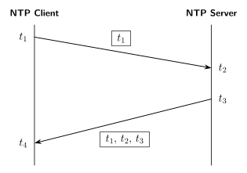{width=75%}

Roundtrip network delay: $\delta = (t_4 - t_1) - (t_3 - t_2)$. Assuming the network delay is the same in both directions, when client is at $t_4$ the server is at $t_3+\frac{\delta}{2}$. Consequently, client's clock skew: $\theta = \left(t_3+\frac{\delta}{2}\right)-t_4 = \frac{(t_2-t_1)+(t_3-t_4)}{2}$.

If the network delay is not the same in both directions, even with NTP synchronization, there could be residual errors.

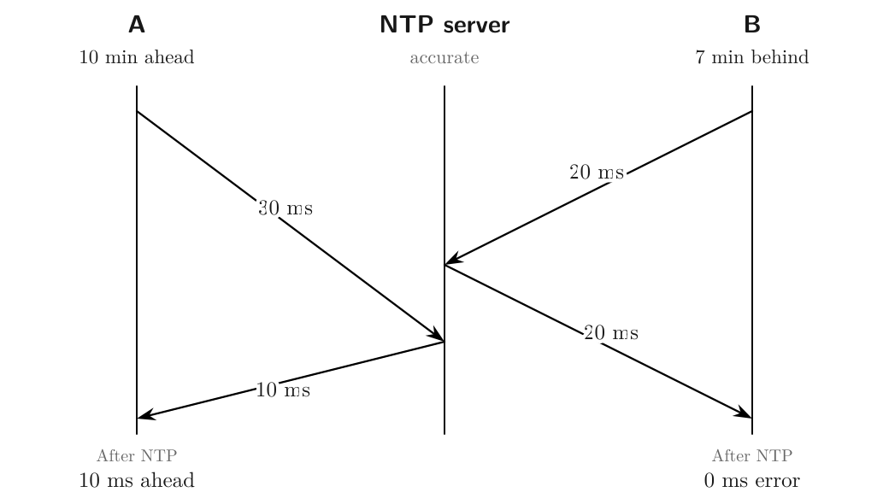

Say between client and an NTP server, the total, forward and return network delays are $\delta$, $\delta_1$ and $\delta_2$. And say $\epsilon$ is the error that remains after NTP synchronization.

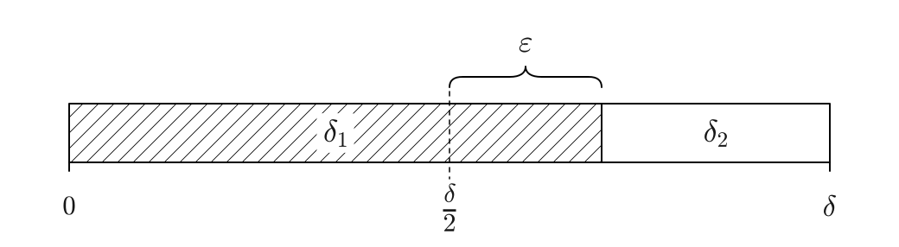

$$
\begin{align}
\epsilon &= \delta_1 - \frac{\delta}{2}\\
         &= \delta_1 - \frac{\delta_1 + \delta_2}{2} \\
         &= \frac{\delta_1 - \delta_2}{2} \\
         &= \frac{ \text{forward-delay} - \text{return-delay} }{2}
\end{align}
$$

## Event ordering using logical clocks

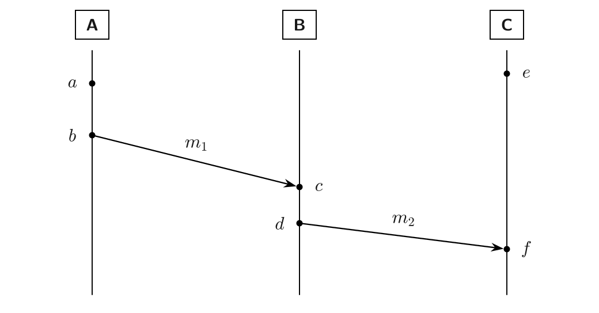

* Events local to one node: $a \rightarrow b$, $c \rightarrow d$, $e \rightarrow f$
* Send, receive events: $b \rightarrow c$, $d \rightarrow f$
* Transitivity: $a \rightarrow c$, $a \rightarrow d$, $a \rightarrow f$, $b \rightarrow d$, $b \rightarrow f$, $c \rightarrow f$
* Concurrent (or causally unrelated): $a \parallel e$, $b \parallel e$, $c \parallel e$, $d \parallel e$

For a logical clock, minimum requirement is: $(a \rightarrow b) \implies (T(a) < T(b))$

### Lamport clock
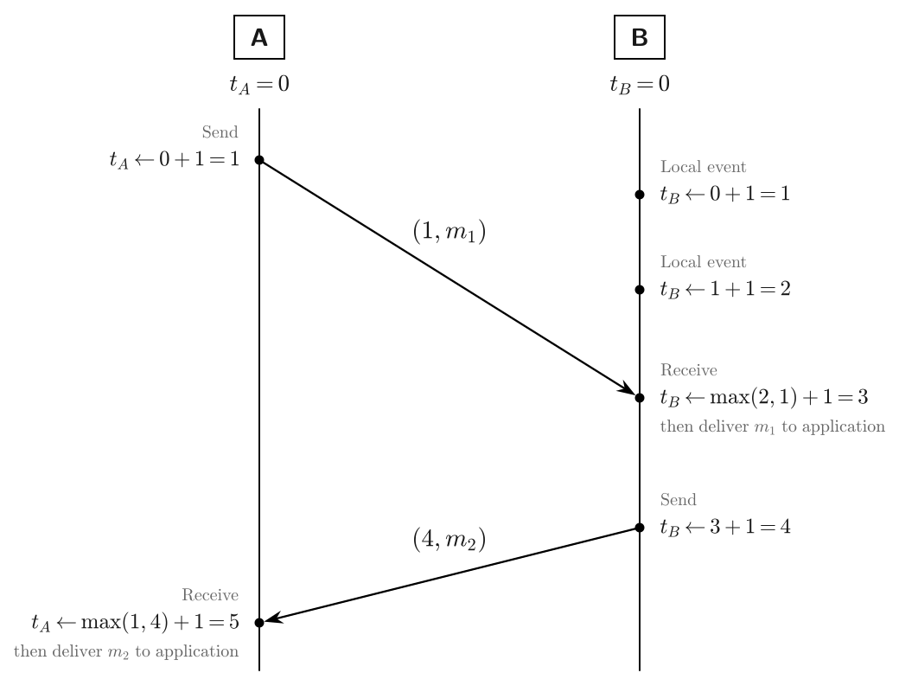

- $(a \rightarrow b) \implies (L(a) < L(b))$. Contrapositively, $(L(a) \ge L(b)) \implies (a \nrightarrow b)$. For example, if $L(a) = 10$ and $L(b) = 5$, we know $a \nrightarrow b$, but cannot distinguish between $b \rightarrow a$ and $a \parallel b$.
- $(L(a) < L(b)) \nRightarrow (a \rightarrow b)$. Comparing Lamport timestamps cannot establish whether one event causally preceded another. Vector clocks address this limitation by allowing us to distinguish causally ordered events from concurrent events.

### Vector clock

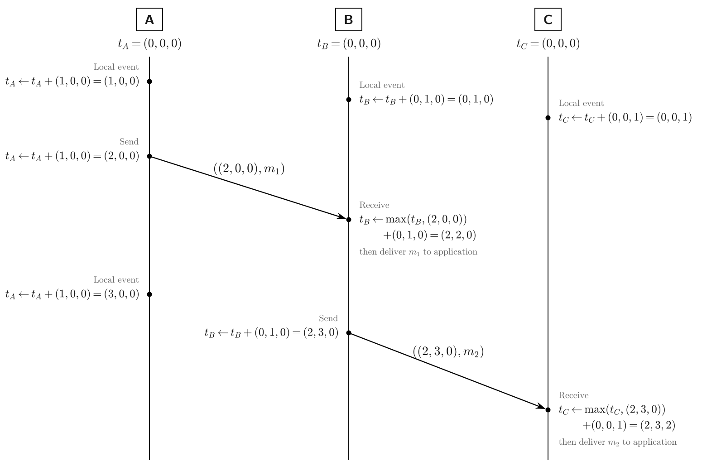{width=100%}

- $V(e)$ encodes $e$ and all events that happen-before $e$: $\{e\} \cup \{a \mid a \rightarrow e\}$. Each component of $V(e)$ tells us how many events from that node belong to this set. For example, if $e$ occurs on node $C$ and $V(e)=(2,3,2)$, the set contains the first two events on $A$, the first three on $B$, and the first two on $C$—including $e$ itself. To identify this set in a time diagram, start at $e$ and trace all paths backward: move to earlier events on the same node and, whenever you encounter a receive event, also follow the message arrow backward to its send event. Continue exploring all such branches. The events you reach, together with $e$, are exactly the set encoded by $V(e)$.
- $(V(a) \le V(b)) \iff (\{a\} \cup \{e\ |\ e \rightarrow a\}) \subseteq (\{b\} \cup \{e\ |\ e \rightarrow b\})$
- $(V(a) < V(b)) \iff (a \rightarrow b)$  
- $(V(a) = V(b)) \iff (a = b)$  
- $(V(a) \parallel V(b)) \iff (a \parallel b)$  

## Broadcast
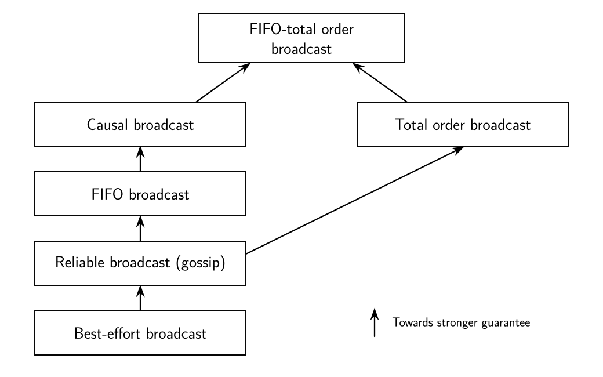

### FIFO
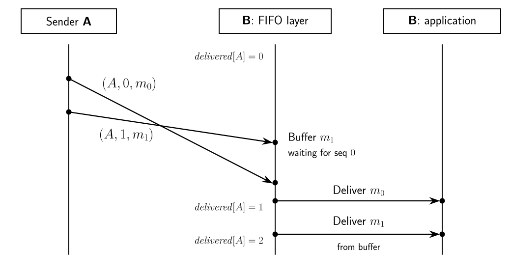

### Causal
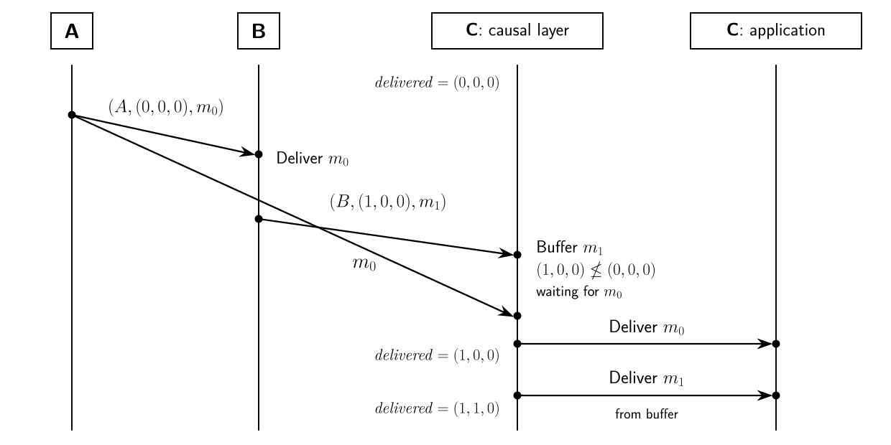

### Total order
- **With leader:** All messages go through a leader node and the leader uses FIFO broadcast. So, all nodes receive all messages in the same order. Fault tolerance depends on safe leader election.
- **Without leader:** Every message has a Lamport timestamp associated with it. Senders use FIFO broadcast. To be able to deliver the message with timestamp $T$, a receiving node waits for message with timestamp $\ge$ $T$ from every node. Not fault tolerant.

# Fault tolerance
* (Eventually Perfect) Failure detector
    - Timeout

## Replicaiton

### Retry

#### Retry semantics

- **At-most-once**: fire and forget
- **At-least-once**: retry until ack'd
- **Exactly-once**: retry + idempotence/deduplication

#### Idempotence
Idempotent request can be retried without deduplication:

- Not-idempotent: $f(\text{likeCount}) = \text{likeCount} + 1$
- Idempotent: $f(\text{likeSet}) = \text{likeSet} \cup \{\text{userID}\}$

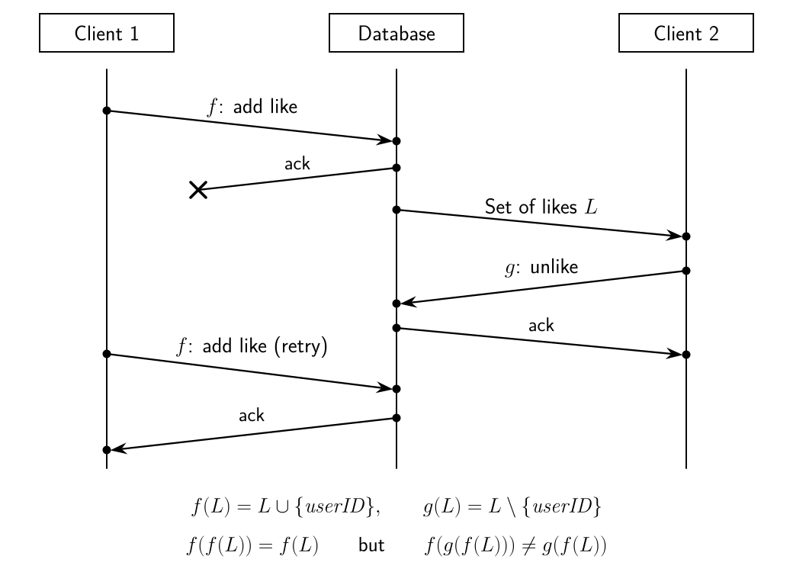

#### Timestamps and tombstones
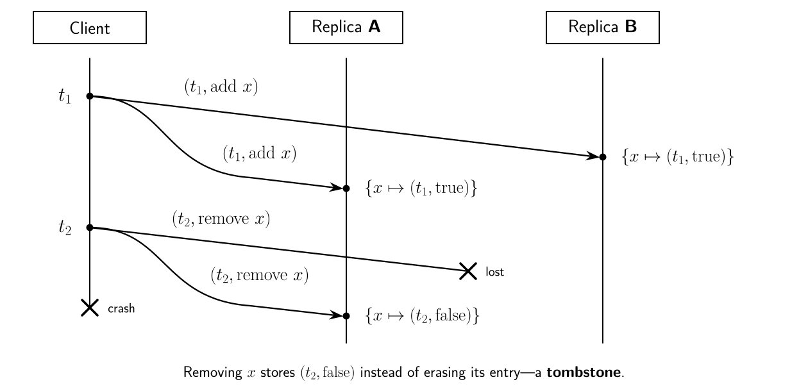

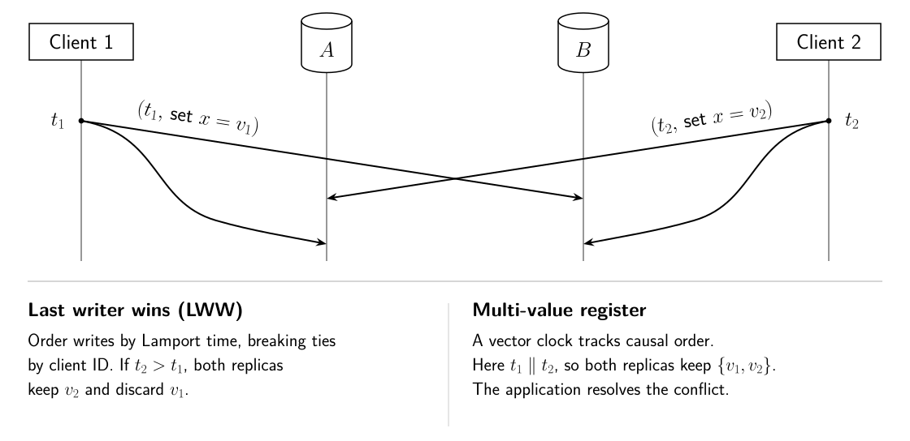

### Read-after-write consistency
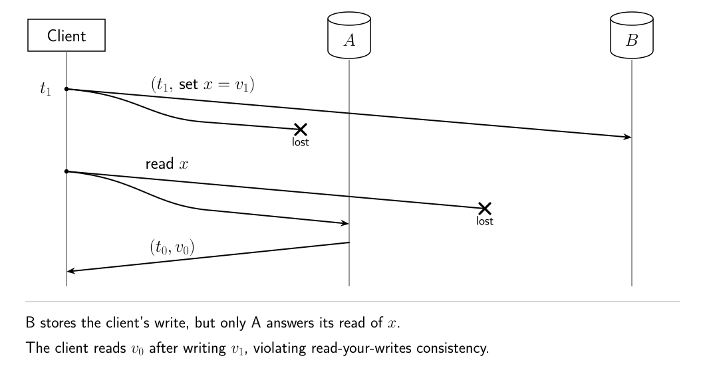
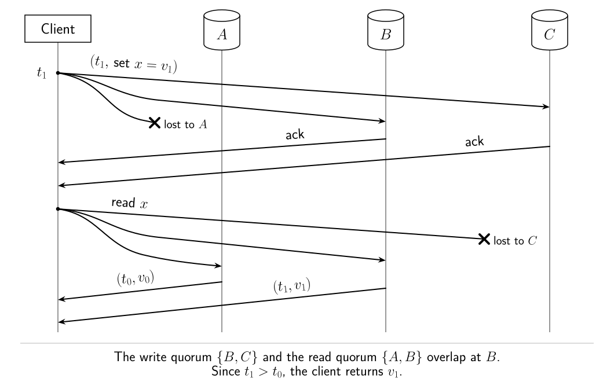
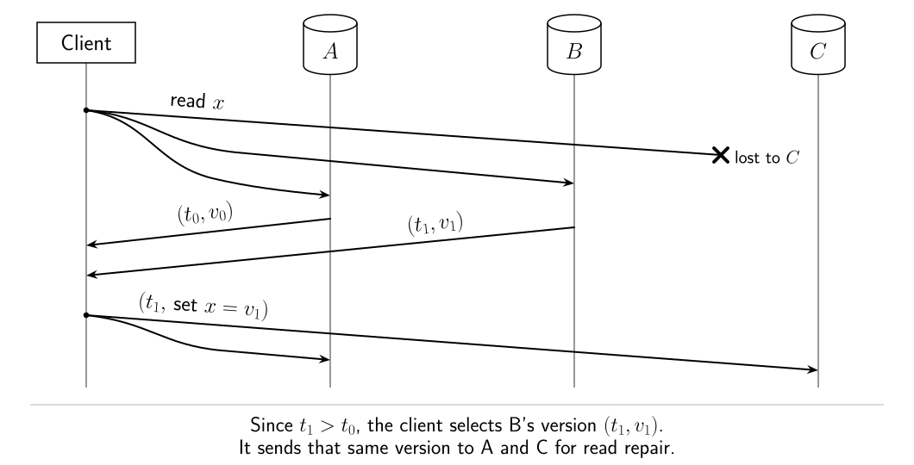

### State machine replication


# Availability

| Nines | Availability | Equivalent downtime/year | Service example | Use case and cost of an outage |
|---|---:|---:|---|---|
| **2** | 99% | **3.65 days** | Personal blog | Readers can return later; interruptions usually cause limited harm. |
| **3** | 99.9% | **8.76 hours** | Gmail in Google Workspace—[SLA](https://workspace.google.com/terms/sla/) | Business email: outages delay communication and everyday work. |
| **4** | 99.99% | **52.6 minutes** | Amazon EC2 across multiple availability zones—[SLA](https://aws.amazon.com/compute/sla/) | Servers running a large online store’s checkout: outages block orders and lose sales. |
| **5** | 99.999% | **5.26 minutes** | Google Spanner across multiple regions—[SLA](https://cloud.google.com/spanner/sla) | Database supporting payment processing: outages prevent customers from paying and merchants from completing transactions. |

Each additional nine reduces the downtime budget by **10×**.

## SLO, SLA

# Assumptions
* Network behavior

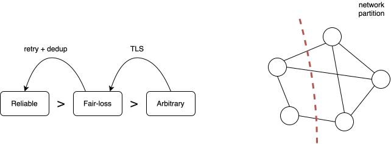

* Node behavior


* Timing behavior


# Failure models
* Two generals problem
* Byzantine generals problem

# Messaging layer
* RPC, REST
* Language-agnostic IDL: Protocol buffer or Thrift

# Sources
* Kleppmann's 2021 lectures:
    - [videos](https://www.youtube.com/playlist?list=PLeKd45zvjcDFUEv_ohr_HdUFe97RItdiB)
    - [notes](https://www.cl.cam.ac.uk/teaching/2021/ConcDisSys/dist-sys-notes.pdf)
* [Caching challenges and strategies from AWS](https://builder.aws.com/content/3K9TeXp6strMiJ4vhakpRD7BQWO/caching-challenges-and-strategies)

