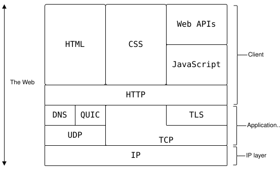
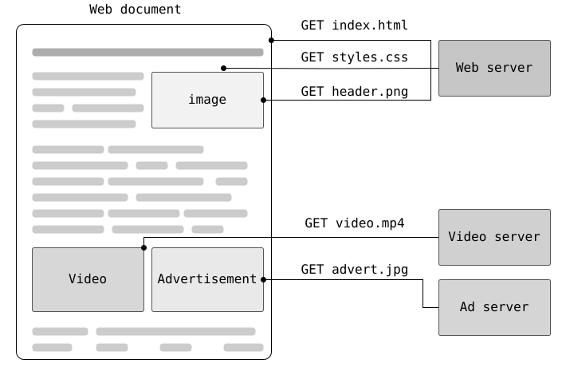

> HTTP (Hypertext Transfer Protocol) is a stateless, human-readable application-layer protocol that operates on a client-server request-response model. A client uses URLs to locate resources and send requests to a server, which processes them and returns responses to transmit hypermedia and data across the web.



**Request**

```http
GET /hello HTTP/1.1
Host: example.com

```

**Response**

```http
HTTP/1.1 200 OK
Content-Type: text/plain
Content-Length: 13

Hello, world!
```

The client requests `/hello`. The server responds with `200 OK` and a
13-byte text body. A blank line separates the headers from the body.



| CRUD operation | HTTP verb | Example | Idempotent? |
|---|---|---|---|
| Create | `POST` | `POST /links` | Not guaranteed |
| Read | `GET` | `GET /links/123` | Yes |
| Update — full replacement | `PUT` | `PUT /links/123` | Yes |
| Update — partial change | `PATCH` | `PATCH /links/123` | Not guaranteed |
| Delete | `DELETE` | `DELETE /links/123` | Yes |

| Status code | Meaning | Example HTTP response |
|---|---|---|
| `200 OK` | Request succeeded | `HTTP/1.1 200 OK`<br>`Content-Type: application/json`<br><br>`{"message":"Success"}` |
| `201 Created` | New resource created | `HTTP/1.1 201 Created`<br>`Location: /items/42`<br>`Content-Type: application/json`<br><br>`{"id":42}` |
| `204 No Content` | Succeeded; no response body | `HTTP/1.1 204 No Content` |
| `301 Moved Permanently` | Permanent redirect | `HTTP/1.1 301 Moved Permanently`<br>`Location: https://example.com/new-page` |
| `302 Found` | Temporary redirect | `HTTP/1.1 302 Found`<br>`Location: https://example.com/temporary-page` |
| `400 Bad Request` | Invalid request | `HTTP/1.1 400 Bad Request`<br>`Content-Type: application/json`<br><br>`{"error":"Invalid request"}` |
| `401 Unauthorized` | Authentication missing or invalid | `HTTP/1.1 401 Unauthorized`<br>`WWW-Authenticate: Bearer`<br>`Content-Type: application/json`<br><br>`{"error":"Authentication required"}` |
| `403 Forbidden` | Access denied | `HTTP/1.1 403 Forbidden`<br>`Content-Type: application/json`<br><br>`{"error":"Access denied"}` |
| `404 Not Found` | Resource not found | `HTTP/1.1 404 Not Found`<br>`Content-Type: application/json`<br><br>`{"error":"Resource not found"}` |
| `429 Too Many Requests` | Rate limit exceeded | `HTTP/1.1 429 Too Many Requests`<br>`Retry-After: 60`<br>`Content-Type: application/json`<br><br>`{"error":"Rate limit exceeded"}` |
| `500 Internal Server Error` | Unexpected server failure | `HTTP/1.1 500 Internal Server Error`<br>`Content-Type: application/json`<br><br>`{"error":"Internal server error"}` |

## Sources
* [Mozilla doc](https://developer.mozilla.org/en-US/docs/Web/HTTP)